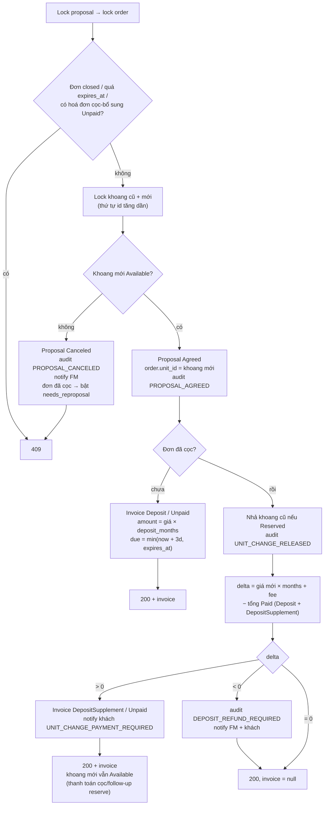
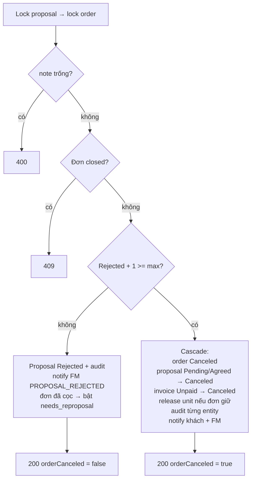
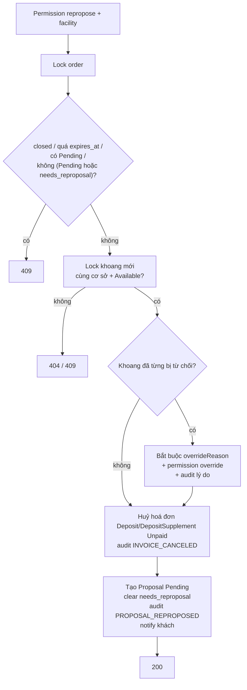

# Đề xuất khoang — đồng ý, từ chối, đề xuất lại

Behavior as-built của Flow 1.3. Contract từng endpoint nằm trong `routes/booking/*`; trang này giữ
overview, state machine và invariant.

## Khách đồng ý — `POST /api/proposals/{id}/agree`

## Khách từ chối — `POST /api/proposals/{id}/reject`

## FM đề xuất lại — `POST /api/rental-orders/{id}/proposals`

## State machines

| Entity | Transition |
|---|---|
| `ProposalFeedback` | `Pending → Agreed` · `Pending → Rejected` · `Pending → Canceled` (unit unavailable) · `Agreed → Canceled` (cascade) |
| `RentalOrder` | `Pending → Deposited` (thanh toán cọc) · `Pending/Deposited/Scheduled/InProgress → Canceled` (cascade) · `Deposited → Scheduled → InProgress → Done` (Flow 1.5/2) |
| `StorageUnit` | `Available ↔ Reserved` (thanh toán cọc / release) · `Available ↔ Maintenance` (Flow 2.5) |
| `Invoice` | `Unpaid → Paid` (thanh toán cọc) · `Unpaid → Canceled` (cascade / re-propose) · `Unpaid → Expired` (cron) |

## Invariants

- Một `Deposit` active (`Unpaid`/`Paid`) + một `DepositSupplement` `Unpaid` trên mỗi đơn — partial unique index của V11.
- Cọc = giá hiệu lực × `invoice.deposit_months`; hạn = `min(now + deposit_due_days, expires_at)`.
- Delta = cọc khoang mới + `fee.unit_change` − tổng `Paid` của `Deposit` + `DepositSupplement`.
- Chỉ nhả khoang khi đơn bị huỷ thực sự giữ khoang (`Deposited`/`Scheduled`/`InProgress`).
- Khoang mới **chưa reserve** ở luồng này — thanh toán cọc/follow-up reserve sau khi thu đủ.
- Audit một bản ghi mỗi entity thay đổi.

## Ranh giới

- **Flow 2** set `needs_reproposal` + gửi `HANDOVER_REJECTED` khi khách từ chối khoang tại check-in; chưa nối.
- **Thanh toán cọc** phải phân biệt `Deposit` và `DepositSupplement`; không mark `Deposited` lần hai cho hoá đơn bổ sung.
- **Flow 4** thực thi hoàn tiền; luồng này chỉ notify + audit.
- **FE** nối endpoint + cảnh báo trước lần từ chối cuối bằng `rejectionCount`/`maxRejectionCount`.
