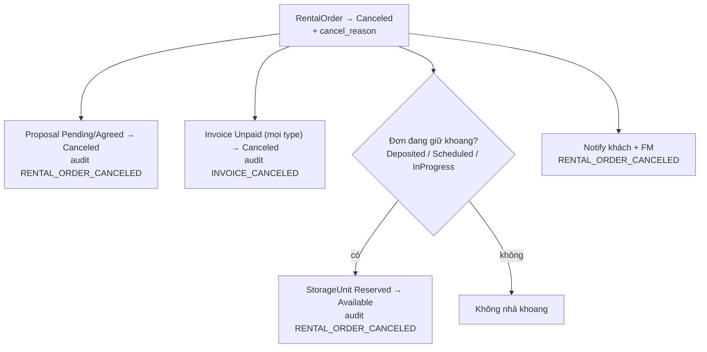

# Cancellation Cascade

Chạy khi `RentalOrder` chuyển `Canceled`. Hiện luồng từ chối quá số khoang cho phép là nơi gọi
cascade; các nguyên nhân khác (khách huỷ, quá hạn, cron) chưa có code. Cascade chạy trong transaction
của caller, đơn đã được caller khoá.

## Sơ đồ

## Các bước

1. `RentalOrder.status → Canceled`, ghi `cancel_reason`; đơn đã đóng thì ném lỗi — caller phải guard.
2. Mọi `ProposalFeedback` `Pending`/`Agreed` của đơn → `Canceled`, audit từng proposal.
3. Mọi `Invoice` `Unpaid` của đơn → `Canceled`, audit từng invoice.
4. Khoang: chỉ nhả `Reserved → Available` khi đơn bị huỷ **thực sự đang giữ khoang**
   (`Deposited`/`Scheduled`/`InProgress`). Đơn `Pending` mới gán `unit_id` chưa cọc nên không nhả.
5. Khách + FM nhận notification `RENTAL_ORDER_CANCELED`; lý do khách chịu rủi ro (quá ngưỡng từ chối)
   thì body nêu rõ "Tiền cọc không được hoàn".
6. Audit một bản ghi mỗi entity thay đổi.

## Ranh giới

- Chưa xử lý `RentalContract` (`Draft`/`Signed → Canceled`), `HandoverRecord` (`IN_PROGRESS → CANCELED`),
  `Appointment` (`Pending → Canceled`) — các module đó chưa có code.
- Hoàn cọc theo `cancel_reason` thuộc Flow 4; cascade chỉ dừng ở notification + audit.
- Các nguyên nhân huỷ khác chưa có entry point: `Khách hủy đơn`, `Khách không còn nhu cầu`,
  `Quá hạn …` (cron).
