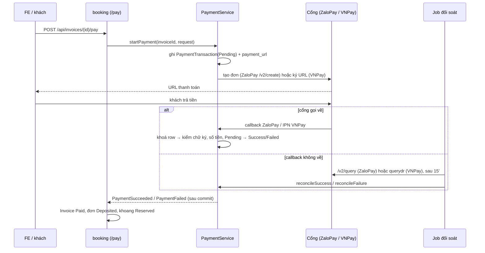

# Payment — luồng thanh toán

Module `payment` (`backend/src/main/java/vn/lemar/selfstorage/payment/`): cổng thanh toán dùng chung
cho thu cọc (Flow 1), thu tháng đầu (Flow 2), thu gia hạn (Flow 3). Các flow gọi cùng một service,
chỉ truyền hóa đơn vào.

**Cổng đang hoạt động** chọn bằng `payment.provider` (`PAYMENT_PROVIDER`): `zalopay` (mặc định) hoặc
`vnpay`. Mỗi lúc chỉ một cổng — chỉ bean `PaymentGateway` + controller callback của cổng đó được
nạp. Nghiệp vụ không đọc mã riêng của cổng: adapter chuẩn hoá callback (`GatewayNotification`) và kết
quả truy vấn (`TransactionQueryResult`).

## Luồng tổng thể

Return URL (`/api/payments/{cổng}/return`) chỉ để hiển thị kết quả cho khách — không ghi DB, không
bắn event.

## Trạng thái `PaymentTransaction`

| Trạng thái | Vào khi | `payment_url` | Ra khi |
|---|---|---|---|
| `Pending` | `startPayment` mở phiên | URL của phiên | callback/IPN, hoặc job đối soát |
| `Success` | callback hợp lệ, IPN `00/00`, hoặc đối soát `SUCCESS` | `NULL` | — (cuối) |
| `Failed` | IPN thất bại, đối soát `FAILED` / `NOT_FOUND` / `PENDING` quá 60' | `NULL` | — (cuối) |

`payment_url` còn bị xoá về `NULL` khi phiên `Pending` quá `PaymentSession.WINDOW` (15') — job đối
soát dọn ở mỗi lần chạy. Row giao dịch và audit không bao giờ bị xoá.

## Hành vi

- **Đồng hồ của hóa đơn: `Invoice.due_date`.** Quá hạn là mốc duy nhất của "quá hạn thanh toán" —
  Flow 6 xử lý (`Expired` + cascade hủy đơn).
  - **LƯU Ý:** đừng nhầm với cửa sổ phiên (`PaymentSession.WINDOW`, 15') — chỉ là giới hạn kỹ thuật
    của cổng; khách bấm trả sát `due_date` vẫn có đủ 15'.
- **Cửa sổ phiên = 15' ở cả hai cổng.** ZaloPay: gửi `expire_duration_seconds = 900` khi tạo đơn,
  không dựa vào mặc định của cổng. VNPay: `vnp_ExpireDate` = lúc tạo URL + 15'.
- **Mã giao dịch theo định dạng của cổng.** ZaloPay bắt buộc `app_trans_id` = `yyMMdd` (giờ VN) +
  `_` + mã nội bộ, tối đa 40 ký tự; VNPay giữ nguyên mã nội bộ. Cột `vnp_txn_ref` lưu đúng mã đã gửi
  cổng để callback và đối soát khớp.
- **Đối soát phiên im lặng.** Khách bỏ ngang (đóng browser, callback không về) để lại giao dịch
  `Pending`. `PaymentReconciliationJob` chạy mỗi 5 phút, chọn `Pending` tạo trước `now - 15'` rồi
  gọi API truy vấn của cổng, adapter chuẩn hoá về một trong năm kết quả:

  | Kết quả | ZaloPay `/v2/query` | VNPay `querydr` | Job làm gì |
  |---|---|---|---|
  | `SUCCESS` | `return_code = 1` | `ResponseCode=00` + `TransactionStatus=00` | `Success` + audit `PAYMENT_SUCCEEDED` + event (số tiền phải khớp) |
  | `FAILED` | `return_code = 2` (trừ `-101`) | `00` + `02/04/07/09` | `Failed` + audit `PAYMENT_FAILED` |
  | `PENDING` | `return_code = 3` | `00` + `01/05/06` | giữ `Pending`; quá 60' vẫn chưa xong → `Failed` |
  | `NOT_FOUND` | `return_code = 2`, `sub_return_code = -101` | `91` | `Failed` |
  | `UNKNOWN` | mã khác | `02/03/94/97/99`, mã lạ | giữ `Pending`, lần sau retry |

  Lỗi mạng hoặc sai chữ ký response cũng giữ `Pending`. Số tiền cổng trả (nếu có) phải khớp
  `PaymentTransaction.amount`; `SUCCESS` mà thiếu hoặc lệch số tiền thì không ghi và log ERROR.
  ZaloPay chỉ trả `amount` khi đã thanh toán, nên adapter bỏ số tiền ở các kết quả khác. Lý do ghi vào
  `failure_reason` có tiền tố `đối soát: `. HTTP truy vấn chạy ngoài transaction; row được khoá lại
  trước khi ghi, callback/IPN thắng nếu đã chốt trước.
- **Xác nhận muộn (lưới an toàn).** Khách đã trả trong cửa sổ hợp lệ nhưng hệ thống chỉ biết sau khi
  invoice/đơn đã hủy: vẫn ghi `Success` + đủ dấu vết, listener booking không chốt đơn và log ERROR để
  vận hành xử lý thủ công (hoàn tiền hoặc xếp chỗ khác). Không tự mở lại đơn.
- **URL phiên.** `startPayment` lưu URL vào `payment_transactions.payment_url` và cache Redis key
  `payment:url:{invoiceId}` (TTL 15'). `/pay` lần nữa trên cùng hoá đơn trả lại URL đang cache; cache
  mất thì `resumePayment` đọc `payment_url` của giao dịch `Pending` còn trong 15' — không tạo giao
  dịch hay đơn mới ở cổng (ZaloPay không cho tạo lại đơn cùng `app_trans_id`). Không còn URL thì
  caller trả 409. Khoá phiên vẫn suy từ `PaymentTransaction(Pending)`, cache không phải khoá. URL
  không được ghi vào log.
- **`vnp_OrderInfo` bỏ dấu trước khi ký** (VNPay chỉ hiển thị được ASCII):
  `Đặt cọc khoang chứa A-01` → `Dat coc khoang chua A-01`.

## Quy tắc bất biến

- **Callback/IPN là nguồn xác nhận chính; nguồn dự phòng duy nhất là API truy vấn của cổng** (cùng
  kênh server-to-server có chữ ký). Return URL nằm trên thanh địa chỉ, khách sửa được — không bao giờ
  dùng để ghi nhận đã trả tiền.
- **Đóng phiên dựa trên kết quả truy vấn cổng, không dựa trên đồng hồ.** Ngưỡng thời gian chỉ để chọn
  lúc hỏi cổng; truy vấn lỗi thì giữ `Pending`.
- **Idempotent theo mã giao dịch (`vnp_txn_ref`).** Cổng retry và có thể gọi song song; row bị khoá
  `PESSIMISTIC_WRITE` khi đọc, lần thứ hai thấy đã chốt và không ghi, không audit, không bắn event
  lần hai. Unique constraint không thay được khoá vì cả hai cùng update một row.
- **Callback ZaloPay không có trạng thái.** ZaloPay chỉ gọi callback khi đã thanh toán thành công
  (`{data, mac, type}`, `mac` = HMAC-SHA256 key2 trên `data`); callback hợp lệ là `SUCCESS`. Thất bại
  hay đang xử lý chỉ biết qua `/v2/query`.
- **Thứ tự kiểm callback ZaloPay:** chữ ký + `app_id` + payload (`return_code = 2`) → tìm giao dịch
  (`0`, ZaloPay gọi lại) → số tiền (`2`) → còn `Pending` (đã chốt: `1`) → ghi (`1`). Lỗi phía hệ
  thống trả `0` để ZaloPay gọi lại. ZaloPay retry tối đa 3 lần khi không nhận `1`.
- **Thứ tự kiểm IPN VNPay:** chữ ký (`97`) → tìm giao dịch (`01`) → `vnp_TmnCode` (`01`)
  → `vnp_Amount` (`04`) → guard trạng thái (`02`) → OK (`00`).
- **Số tiền:** nguồn tin cậy là **hóa đơn trong DB** — caller đọc `Invoice` rồi truyền vào
  `startPayment`; `payment` không import `booking`. VNPay nhận `amount × 100`; ZaloPay nhận số nguyên
  VND.
- **Không mở phiên mới khi đã có giao dịch `PAY/Success`.** Callback ghi giao dịch trước khi listener
  booking chạy; nếu listener chưa chạy/lỗi, invoice vẫn `Unpaid`. `/pay` trả 409, không thu lần hai.
- **Ranh giới module:** `PaymentTransaction.invoiceId` là `Long`, không quan hệ JPA với `invoices`;
  module khác giao tiếp qua event.
- **Listener event bắt buộc `AFTER_COMMIT`.** `PaymentSucceeded`/`PaymentFailed` được publish *trong*
  transaction callback — module nghe dùng `@TransactionalEventListener(phase = AFTER_COMMIT)`
  (+ `REQUIRES_NEW` nếu ghi). Listener đồng bộ mặc định thấy state chưa commit, và exception từ
  listener sẽ rollback giao dịch khiến cổng retry.
- **Không dùng `ApiEnvelope` cho callback/IPN.** Cổng đọc đúng key của họ ở mức gốc
  (`return_code`/`return_message` với ZaloPay, `RspCode`/`Message` với VNPay).
- **Đổi cổng chỉ khi không còn phiên đang mở.** Giao dịch `Pending` của cổng cũ không được cổng mới
  đối soát (bảng chưa có cột provider).

## Cấu hình

| Biến | Ý nghĩa | Mặc định |
|---|---|---|
| `PAYMENT_PROVIDER` | Cổng đang hoạt động: `zalopay` hoặc `vnpay` | `zalopay` |
| `ZALOPAY_APP_ID`, `ZALOPAY_KEY1`, `ZALOPAY_KEY2` | App và key do ZaloPay cấp (key1 ký đơn/truy vấn, key2 kiểm callback) | — (thiếu thì tạo phiên/truy vấn báo lỗi cấu hình) |
| `ZALOPAY_CREATE_URL`, `ZALOPAY_QUERY_URL` | Endpoint tạo đơn / truy vấn | sandbox `https://sb-openapi.zalopay.vn/v2/...` |
| `ZALOPAY_CALLBACK_URL` | URL public cho callback (dev: ngrok tới `/api/payments/zalopay/callback`) | trống = dùng URL đăng ký với ZaloPay |
| `ZALOPAY_REDIRECT_URL` | Return URL sau thanh toán | `http://localhost:8080/api/payments/zalopay/return` |
| `VNPAY_*` | Xem bên dưới | — |

Bốn biến `VNPAY_*` vẫn fail-fast (`VnPayProperties @NotBlank`) kể cả khi chạy `zalopay`:
`VNPAY_TMN_CODE`, `VNPAY_HASH_SECRET`, `VNPAY_PAY_URL`, `VNPAY_RETURN_URL`. `VNPAY_QUERYDR_URL` mặc
định trỏ sandbox. Hướng dẫn sandbox VNPay: `docs/vnpay-sandbox.md`.

## Trạng thái hiện tại

- **ZaloPay (mặc định):** tạo đơn `/v2/create`, callback, truy vấn `/v2/query` cho job đối soát.
  Hoàn tiền (`/v2/refund`) chưa có trong code — hoàn tiền thủ công/Flow 4.
- **VNPay:** URL ký, IPN, Return, `querydr` — giữ để chạy lại khi `PAYMENT_PROVIDER=vnpay`.
- **Endpoint khởi tạo thanh toán `POST /api/invoices/{invoiceId}/pay`** — mở phiên cho hoá đơn
  `Deposit`/`DepositSupplement`; contract ở `routes/booking/invoice-pay.md`.
- **`booking` nghe `PaymentSucceeded`** — `DepositPaymentListener` chốt hoá đơn, đơn và khoang;
  `PaymentFailed` chỉ ghi log vì khoá phiên tự hết hạn.
- **Chặn hủy đơn khi phiên thanh toán còn mở: chưa có trong code.**
